# Database Design

* ORM: SQLAlchemy 2.0 (typed `Mapped[]` declarative models).
* Migrations: Alembic (`backend/migrations`). Every schema change is a migration; models are the
  source of truth and `alembic revision --autogenerate` is used to produce them.
* Development: SQLite (`sqlite:///./data/app.db`, WAL mode, foreign keys ON).
* Production: PostgreSQL (`postgresql+psycopg://...`). No dialect-specific SQL in business logic;
  dialect differences are handled in `app/core/database.py` and in migrations.

## Conventions

| Convention | Detail |
|---|---|
| Primary keys | Integer surrogate `id` plus `public_id` UUID (string(36)) for every externally visible entity |
| Tenant column | `organization_id` on every tenant-owned table, indexed |
| Timestamps | `created_at`, `updated_at` (UTC, timezone-aware) via `TimestampMixin` |
| Soft delete | `deleted_at` via `SoftDeleteMixin` on master-data tables (organizations, branches, professionals, services, customers, users) |
| Money | Integer **paise** (`*_paise` columns), currency code column where relevant |
| Times | Stored in UTC `DateTime(timezone=True)`; business timezone stored on organization/branch |
| Enums | Stored as short strings (`String(32)`) validated by Python `StrEnum`s, so adding a value is a code change only |
| Naming | snake_case tables, `ix_<table>_<cols>` indexes, `uq_<table>_<cols>` unique constraints, `fk_<table>_<col>_<ref>` foreign keys |

## Entity-relationship diagram

```mermaid
erDiagram
    ORGANIZATIONS ||--o{ ORGANIZATION_SETTINGS : has
    ORGANIZATIONS ||--o{ ORGANIZATION_DOMAINS : has
    ORGANIZATIONS ||--o{ ORGANIZATION_SUBSCRIPTIONS : has
    ORGANIZATIONS ||--o{ BRANCHES : has
    BRANCHES ||--o| BRANCH_SETTINGS : has
    ORGANIZATIONS ||--o{ ORGANIZATION_MEMBERSHIPS : has
    USERS ||--o{ ORGANIZATION_MEMBERSHIPS : has
    ROLES ||--o{ ORGANIZATION_MEMBERSHIPS : assigned
    ROLES ||--o{ ROLE_PERMISSIONS : has
    PERMISSIONS ||--o{ ROLE_PERMISSIONS : has
    USERS ||--o{ USER_SESSIONS : has
    USERS ||--o{ OTP_VERIFICATIONS : requests

    ORGANIZATIONS ||--o{ PROFESSIONALS : employs
    USERS |o--o{ PROFESSIONALS : "login for"
    PROFESSIONALS ||--o{ PROFESSIONAL_BRANCHES : works_at
    BRANCHES ||--o{ PROFESSIONAL_BRANCHES : hosts
    PROFESSIONALS ||--o{ PROFESSIONAL_SERVICES : offers
    SERVICES ||--o{ PROFESSIONAL_SERVICES : offered_by

    ORGANIZATIONS ||--o{ SERVICE_CATEGORIES : has
    SERVICE_CATEGORIES ||--o{ SERVICES : groups
    SERVICES ||--o{ SERVICE_PRICING : priced_at
    BRANCHES |o--o{ SERVICE_PRICING : for
    SERVICES ||--o{ SERVICE_PACKAGES : bundles

    PROFESSIONALS ||--o{ SCHEDULES : has
    BRANCHES ||--o{ SCHEDULES : at
    PROFESSIONALS ||--o{ SCHEDULE_EXCEPTIONS : has
    ORGANIZATIONS ||--o{ HOLIDAYS : observes
    PROFESSIONALS ||--o{ PROFESSIONAL_LEAVES : takes
    PROFESSIONALS ||--o{ APPOINTMENT_SLOTS : generates

    ORGANIZATIONS ||--o{ CUSTOMERS : serves
    USERS |o--o{ CUSTOMERS : "login for"
    CUSTOMERS ||--o{ CUSTOMER_DEPENDENTS : has
    CUSTOMERS ||--o{ CUSTOMER_NOTES : has
    CUSTOMERS ||--o{ CUSTOMER_DOCUMENTS : has

    CUSTOMERS ||--o{ APPOINTMENTS : books
    PROFESSIONALS ||--o{ APPOINTMENTS : serves
    BRANCHES ||--o{ APPOINTMENTS : at
    SERVICES ||--o{ APPOINTMENTS : for
    CUSTOMER_DEPENDENTS |o--o{ APPOINTMENTS : for
    APPOINTMENTS ||--o{ APPOINTMENT_STATUS_HISTORY : logs
    APPOINTMENTS ||--o{ APPOINTMENT_RESCHEDULES : has
    APPOINTMENTS ||--o| APPOINTMENT_CANCELLATIONS : has
    PROFESSIONALS ||--o{ BOOKING_HOLDS : reserved
    BOOKING_HOLDS |o--o| APPOINTMENTS : converts_to

    ORGANIZATIONS ||--o{ BOOKING_FORMS : defines
    BOOKING_FORMS ||--o{ BOOKING_FORM_FIELDS : has
    BOOKING_FORMS ||--o{ BOOKING_FORM_RESPONSES : receives
    APPOINTMENTS ||--o{ BOOKING_FORM_RESPONSES : has

    ORGANIZATIONS ||--o{ UPI_ACCOUNTS : owns
    BRANCHES |o--o{ UPI_ACCOUNTS : scoped
    UPI_ACCOUNTS ||--o{ PAYMENTS : collects
    APPOINTMENTS ||--o{ PAYMENTS : paid_by
    CUSTOMERS ||--o{ PAYMENTS : pays
    PAYMENTS ||--o{ PAYMENT_SUBMISSIONS : has
    PAYMENTS ||--o{ PAYMENT_VERIFICATION_LOGS : audited
    PAYMENTS ||--o{ PAYMENT_REFUNDS : refunded
    ORGANIZATIONS ||--o{ BANK_STATEMENT_IMPORTS : imports
    BANK_STATEMENT_IMPORTS ||--o{ BANK_TRANSACTIONS : contains
    PAYMENTS |o--o{ BANK_TRANSACTIONS : matched_to

    ORGANIZATIONS ||--o{ NOTIFICATION_TEMPLATES : has
    ORGANIZATIONS ||--o{ NOTIFICATIONS : sends
    USERS |o--o{ NOTIFICATIONS : receives
    NOTIFICATIONS ||--o{ NOTIFICATION_LOGS : delivery

    ORGANIZATIONS ||--o{ INTEGRATIONS : configures
    ORGANIZATIONS ||--o{ API_KEYS : issues
    ORGANIZATIONS ||--o{ WEBHOOK_ENDPOINTS : registers
    WEBHOOK_ENDPOINTS ||--o{ WEBHOOK_EVENTS : delivers
    INTEGRATIONS ||--o{ INTEGRATION_LOGS : logs

    ORGANIZATIONS |o--o{ AUDIT_LOGS : scoped
    USERS |o--o{ AUDIT_LOGS : actor
    SYSTEM_SETTINGS

    ORGANIZATIONS {
        int id PK
        uuid public_id UK
        string slug UK
        string name
        string legal_name
        string email
        string phone
        string timezone
        string currency
        string status
        text address_json
        string logo_url
        datetime deleted_at
    }
    BRANCHES {
        int id PK
        uuid public_id UK
        int organization_id FK
        string name
        string code
        string timezone
        text address_json
        json business_hours
        bool is_active
    }
    USERS {
        int id PK
        uuid public_id UK
        string email UK
        string mobile UK
        string password_hash
        string status
        bool is_platform_admin
        bool email_verified
        bool mobile_verified
    }
    ORGANIZATION_MEMBERSHIPS {
        int id PK
        int organization_id FK
        int user_id FK
        int role_id FK
        int branch_id FK
        string status
    }
    PROFESSIONALS {
        int id PK
        uuid public_id UK
        int organization_id FK
        int user_id FK
        string display_name
        string specialization
        string registration_number
        int default_duration_minutes
        int buffer_minutes
        bool is_active
    }
    SERVICES {
        int id PK
        uuid public_id UK
        int organization_id FK
        int category_id FK
        string name
        int duration_minutes
        int price_paise
        int discounted_price_paise
        int advance_amount_paise
        string payment_mode
        string consultation_mode
        bool is_active
    }
    APPOINTMENTS {
        int id PK
        uuid public_id UK
        string reference UK
        int organization_id FK
        int branch_id FK
        int professional_id FK
        int service_id FK
        int customer_id FK
        datetime start_at
        datetime end_at
        string status
        string source
        int total_amount_paise
        int paid_amount_paise
    }
    BOOKING_HOLDS {
        int id PK
        uuid public_id UK
        int organization_id FK
        int professional_id FK
        int branch_id FK
        datetime start_at
        datetime end_at
        datetime expires_at
        string status
    }
    UPI_ACCOUNTS {
        int id PK
        uuid public_id UK
        int organization_id FK
        int branch_id FK
        string display_name
        string upi_id
        string merchant_name
        string static_qr_path
        bool is_default
        bool is_active
    }
    PAYMENTS {
        int id PK
        uuid public_id UK
        string reference UK
        int organization_id FK
        int appointment_id FK
        int customer_id FK
        int upi_account_id FK
        int amount_paise
        string currency
        string method
        string status
        datetime expires_at
    }
    PAYMENT_SUBMISSIONS {
        int id PK
        int payment_id FK
        string utr
        string transaction_reference
        datetime paid_at
        string screenshot_path
        text notes
    }
    PAYMENT_VERIFICATION_LOGS {
        int id PK
        int payment_id FK
        int actor_user_id FK
        string action
        string from_status
        string to_status
        text reason
    }
```



## Table inventory (54 tables)

**Organization**: organizations, organization_settings, organization_domains, organization_subscriptions
**Branch**: branches, branch_settings
**Auth**: users, user_sessions, otp_verifications, roles, permissions, role_permissions, organization_memberships
**Professional**: professionals, professional_branches, professional_services
**Service**: service_categories, services, service_pricing, service_packages, service_package_items
**Scheduling**: schedules, schedule_exceptions, holidays, professional_leaves, appointment_slots
**Customer**: customers, customer_dependents, customer_notes, customer_documents
**Appointments**: appointments, appointment_status_history, appointment_reschedules, appointment_cancellations, booking_holds
**Booking forms**: booking_forms, booking_form_fields, booking_form_responses
**Payments**: upi_accounts, payments, payment_submissions, payment_verification_logs, payment_refunds, bank_statement_imports, bank_transactions
**Notifications**: notifications, notification_templates, notification_logs
**Integrations**: integrations, api_keys, webhook_endpoints, webhook_events, integration_logs
**Admin**: audit_logs, system_settings

## Critical constraints

| Constraint | Purpose |
|---|---|
| `uq_appointments_active_slot` partial unique on `(professional_id, branch_id, start_at)` where status in active set | Hard stop against double booking (PostgreSQL partial index; SQLite partial index supported too) |
| `uq_booking_holds_slot` unique on `(professional_id, branch_id, start_at)` where status = 'active' | One hold per slot |
| `uq_payments_reference` | Unique payment reference embedded in UPI `tn` |
| `uq_payment_submissions_org_utr` on `(organization_id, utr)` | Duplicate UTR detection |
| `uq_memberships_user_org_role_branch` | No duplicate role grants |
| `uq_upi_accounts_org_upi_id` | No duplicate UPI IDs per organization |
| `ck_payments_amount_positive` | Amount validity |

## Migration workflow

```bash
cd backend
alembic revision --autogenerate -m "describe change"
alembic upgrade head
alembic downgrade -1   # rollback one step
```

Migrations use `render_as_batch=True` so that ALTER TABLE operations work on SQLite as well as
PostgreSQL.

## PostgreSQL in production

PostgreSQL 17 is the production database (the Docker stack runs it); SQLite stays the zero-setup database for a
single PC. The whole test suite runs on both in CI, so a feature that works in development works in production.

Differences that matter, and how the code handles them:

| SQLite | PostgreSQL | Handled by |
|---|---|---|
| ignores `VARCHAR(n)` lengths | rejects longer values | `test_enum_backed_columns_fit_every_enum_value`; the suite on PostgreSQL (it found `api_keys.key_prefix` too short) |
| one writer at a time | parallel transactions | row locks on every status-dependent write; `tests/test_races.py` (see architecture.md) |
| no ID sequences | sequences per table | the data migration tool moves them past copied rows |
| plain `CREATE INDEX` | can build without blocking writes | new indexes use `CREATE INDEX CONCURRENTLY` in migrations |

Connection settings (environment variables): `DATABASE_POOL_SIZE` (10) and `DATABASE_MAX_OVERFLOW` (20) per API
process; `DATABASE_POOL_TIMEOUT_SECONDS` (10) fails fast when every connection is busy instead of hanging;
`DATABASE_STATEMENT_TIMEOUT_MS` (30000) makes PostgreSQL cancel any runaway query; `DATABASE_SLOW_QUERY_MS` (500) logs
slower statements with their SQL text (never their parameter values, which hold names, mobiles and UTRs). With
`WEB_CONCURRENCY` worker processes the API can open up to `WEB_CONCURRENCY × (pool size + overflow)` connections;
PostgreSQL's default limit is 100.

## Moving existing data from SQLite to PostgreSQL

For a clinic that started on the Windows/SQLite setup and is moving to the production server. Plan 15 minutes of
downtime for bookings.

1. **On the PC**, stop the API and worker, then back up, bring the SQLite database to the current schema, and make
   it one complete file (SQLite keeps recent changes in a side file, `app.db-wal`, that a plain copy would miss):

   ```powershell
   cd backend
   .\.venv\Scripts\Activate.ps1
   python ..\scripts\backup.py create
   alembic upgrade head
   python -m app.ops.migrate_data --prepare-sqlite data\app.db
   ```

2. **On the server**, install as in `deployment.md` (sections 2 and 3) with the **same** `DATA_ENCRYPTION_KEY` and
   `SECRET_KEY` as the PC's `backend/.env` (clinical notes are encrypted with it; a different key makes them
   unreadable). Start once so the database is created, then stop everything except the database:

   ```bash
   docker compose up -d && docker compose stop caddy web api worker backup
   ```

3. **Copy the SQLite file and the uploads to the server** (PowerShell on the PC):

   ```powershell
   scp backend\data\app.db root@<server-ip>:/opt/appointment/app.db
   scp -r backend\uploads root@<server-ip>:/opt/appointment/uploads-import
   ```

4. **Rehearse, then import** (on the server). `--dry-run` checks everything and writes nothing:

   ```bash
   docker compose run --rm -v /opt/appointment/app.db:/import/app.db:ro api \
     sh -c 'python -m app.ops.migrate_data --source sqlite:////import/app.db --target "$DATABASE_URL" --dry-run'
   ```

   ```bash
   docker compose run --rm -v /opt/appointment/app.db:/import/app.db:ro api \
     sh -c 'python -m app.ops.migrate_data --source sqlite:////import/app.db --target "$DATABASE_URL"'
   ```

   The tool copies every table in one transaction, keeps every ID, moves the ID counters past the copied rows, and
   then compares row counts and a SHA-256 checksum of every table with the source. Any difference, or any other
   error, rolls the whole import back. It refuses a database that already holds clinics or users, so it can never
   overwrite live data. (Roles, permissions and platform settings created by the first start are replaced by the
   PC's own copies.)

5. **Copy the uploads into the uploads volume and start:**

   ```bash
   docker run --rm -v appointment_uploads:/data -v /opt/appointment/uploads-import:/import:ro alpine sh -c 'cp -a /import/. /data/ && chown -R 10001:10001 /data'
   docker compose up -d
   ```

6. **Check**: sign in, open a patient's notes (proves the encryption key matches), open a payment screenshot (proves
   the uploads arrived), make a test booking, and look at Super admin → System health. Keep `app.db` and the PC
   backup until the first nightly backup on the server has succeeded.

